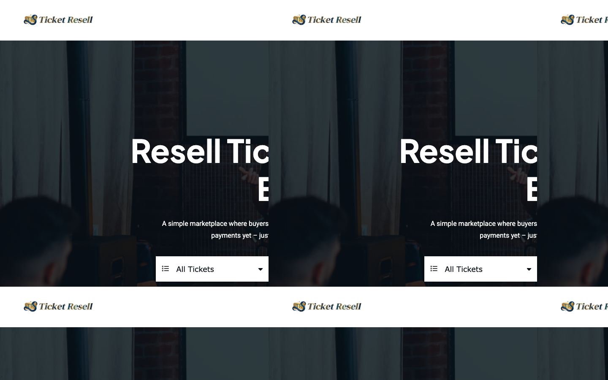
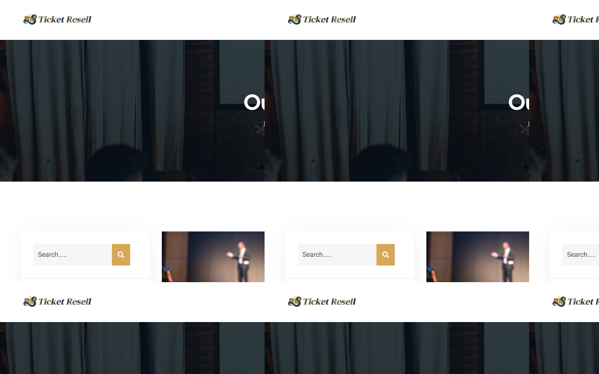
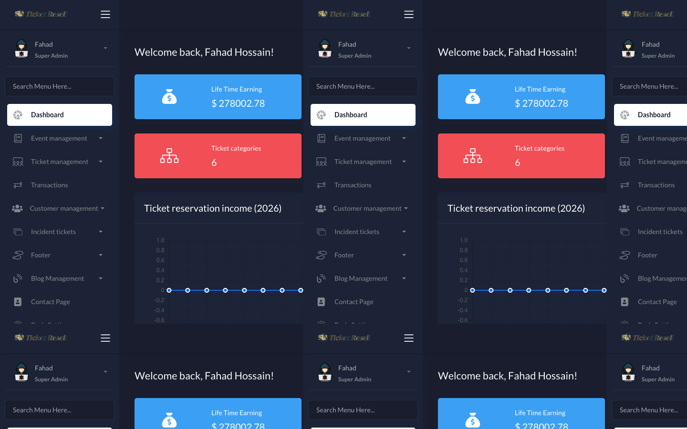
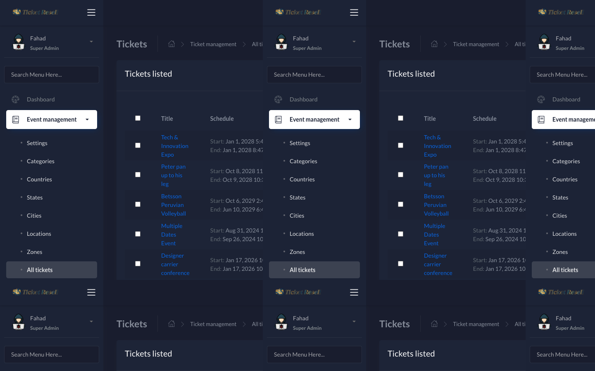
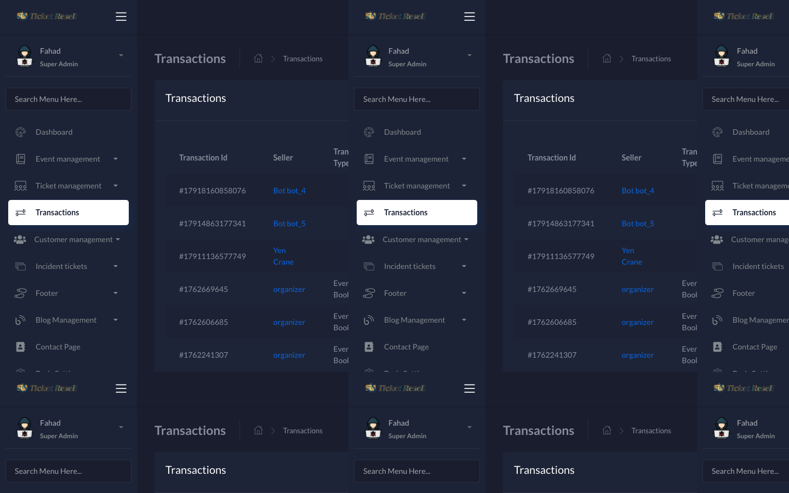
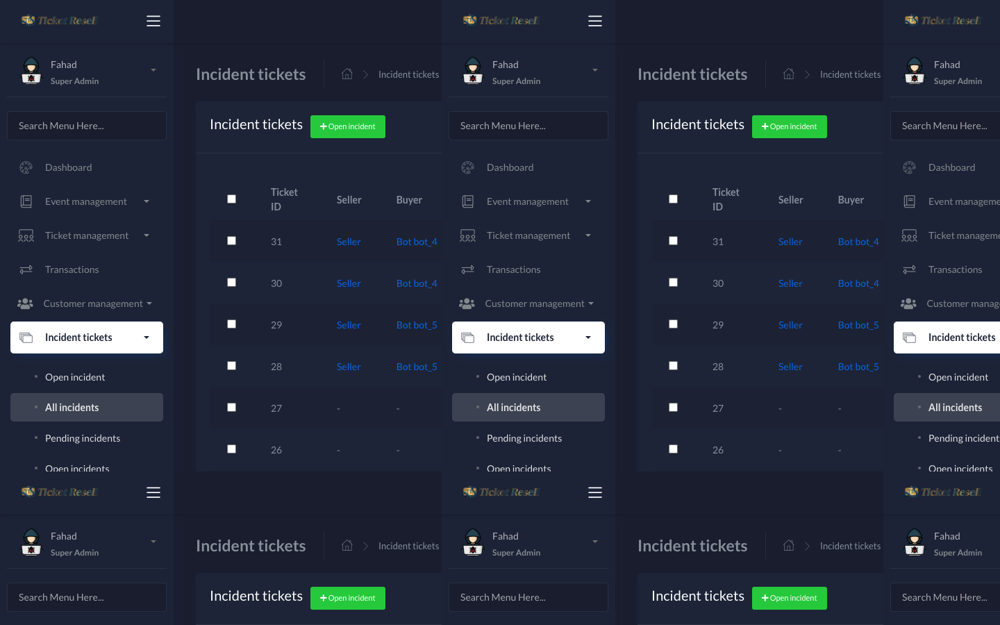

# Ticket ReSell

Peer-to-peer **event ticket resale marketplace** on Laravel — anonymous buyer/seller matching, FIFO allocation, escrow wallet, trust scoring, transfer deadlines, and admin ops for events, bookings, transactions, and incidents.

---

## Why this is useful

Secondary-ticket marketplaces fail when identity leaks, stock oversells, money settles too early, or disputes have no process. This product focuses on those hard parts:

| Pain | What the platform does |
|------|------------------------|
| Buyers see who they’re buying from | **Seller anonymity** in UI + queries — buyers only see zone, price, availability |
| Race conditions on popular listings | **FIFO matching** + reservation hold with live countdown |
| Partial quantity from a multi-ticket listing | **Ticket splitting** — child listing for buyer, remainder stays listed |
| Seller can’t deliver on time | **Transfer deadlines**, auto-refund, deprioritized relist, **equivalent-ticket** offer |
| Money released before event risk clears | Simulated **escrow** held until **T+48h** (or litigation resolution) |
| Repeat bad actors | Bayesian **confidence / risk tiers** that gate listings & purchases |
| Ops blind spots | Admin: events, bookings, transactions, buyers/sellers, **incident/litigation** settlement |

---

## Screenshots

### Storefront
| | |
|--|--|
| Home |  |
| Events |  |
| Event details + resale block |  |

### Admin
| | |
|--|--|
| Dashboard |  |
| Tickets / events |  |
| Transactions |  |
| Incidents |  |

---

## Resale flow

- **List a ticket** with price + zone/category (suggested from event zones / prior listings)
- **FIFO buy** on the event page: `(zone, price)` groups with quantity stepper + Buy
- **Reservation window** with countdown; cancel or change quantity
- **Wallet credit as discount** from platform balance (not escrow)
- **Conditional PDF upload** at listing for internal-transfer events (availability rules)
- **Auto-complete at payment** when seller already has PDF on file
- **Transfer deadlines** from event start `T`, allocation `t`, availability `h`
- Missed deadline → cancel + refund + deprioritized relist; second miss → auto-cancel
- **My Transfers** for sellers (pending / done / failed)

---

## Trust & safety

| Internal tier | User-facing | Restrictions |
|---------------|-------------|--------------|
| `HIGH` | **LOW RISK** | none (new users start here) |
| `MEDIUM` | **MEDIUM RISK** | deprioritized in FIFO |
| `LOW` | **HIGH RISK** | deprioritized + max 1 active listing / 1 open purchase |
| `BANNED` | **BANNED** | suspended; open listings cancelled |

Score inputs track successful releases and litigations the user is responsible for (plus unclear rulings). Litigations reuse support tickets and can delay payout until admin settlement.

---

## Money (simulated, no gateway on resale)

| Balance | Role |
|---------|------|
| `platform_balance` | Spendable wallet (discounts, refunds, withdrawable) |
| `escrow_balance` | Buyer funds held for active purchase |
| `withdrawable_balance` | Seller proceeds after release |

Buyer payment → escrow → settle to seller withdrawable after event safety window (unless litigation redirects). Withdrawals requested by customers; admins approve out-of-band.

---

## Admin capabilities

- Event management (categories, geo, zones, tickets, featured/status)
- Bookings (all / on hold)
- Transactions export
- Buyer / seller management
- Incident tickets (pending / open / closed) + litigation settlement
- Roles & permissions, basic settings, PWA scanner hooks

---

## Tech stack

| Layer | Choice |
|-------|--------|
| Framework | **Laravel 9** |
| Language | **PHP ^8.0.2** |
| Database | **MySQL** |
| UI | Blade |
| PDF / QR / Excel | DomPDF, Simple QrCode, Maatwebsite Excel |
| Trust score | Python (`scipy`) via Symfony Process + PHP fallback |
| Base ticketing payments | PayPal / Stripe / Mollie / Razorpay / … (primary flow; resale uses internal wallet) |

---

## Local setup

```bash
composer install
cp .env.example .env
php artisan key:generate
# configure DB in .env
php artisan migrate --seed
php artisan serve
```

Optional: install Python deps for confidence scoring (`scripts/install-python-deps.sh`) and set `RESALE_PYTHON_BIN` if needed.
